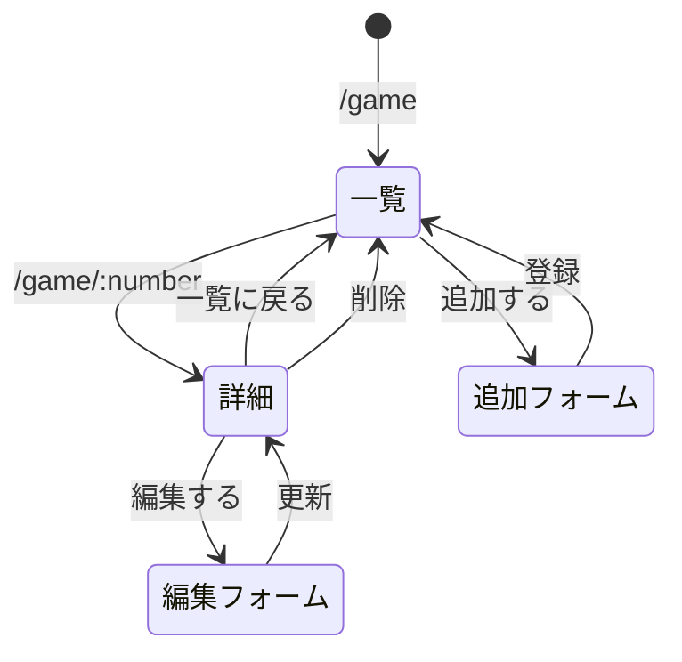
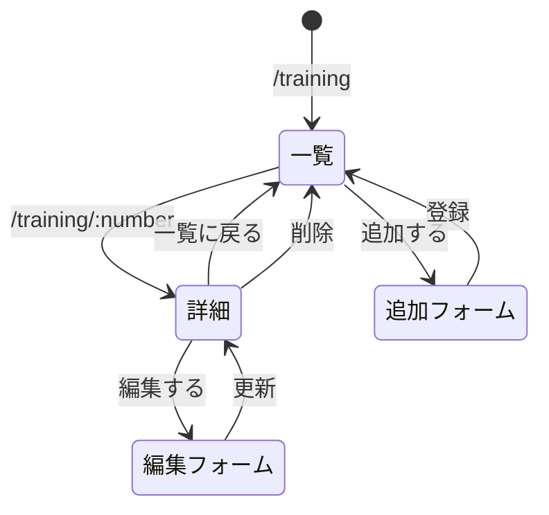

# レポート用システムの設計

基本的なデータ表示のWebアプリケーションとして，京葉線システム以外に以下の3つを開発する．
いずれも一覧表示をベースとし，REST APIでデータの一覧・詳細表示，追加，削除，変更を行う．
データはDBではなく，JSファイル内の変数（配列）に記録する．

---

## システム1：アニメ一覧

### 対象
視聴したアニメ作品を管理する．作品名，放送開始年，制作会社，話数，評価を記録する．

### スキーマ

| 項目名 | 型 | 内容 |
| --- | --- | --- |
| id | 数値 | 作品ID |
| title | 文字列 | 作品名 |
| year | 数値 | 放送開始年 |
| studio | 文字列 | 制作会社 |
| episodes | 数値 | 話数 |
| rating | 数値 | 評価（1〜5） |

### ページ遷移

---

## システム2：ゲームの記録

### 対象
プレイしているゲームを管理する．タイトル，ジャンル，対応機種，プレイ時間，クリア状況を記録する．

### スキーマ

| 項目名 | 型 | 内容 |
| --- | --- | --- |
| id | 数値 | ゲームID |
| title | 文字列 | タイトル |
| genre | 文字列 | ジャンル |
| platform | 文字列 | 対応機種 |
| hours | 数値 | プレイ時間（時間） |
| cleared | 真偽値 | クリアしたかどうか |

### ページ遷移

---

## システム3：筋トレメニュー

### 対象
筋力トレーニングの種目を管理する．種目名，鍛える部位，重量，回数，セット数を記録する．

### スキーマ

| 項目名 | 型 | 内容 |
| --- | --- | --- |
| id | 数値 | 種目ID |
| name | 文字列 | 種目名 |
| part | 文字列 | 鍛える部位 |
| weight | 数値 | 重量（kg） |
| reps | 数値 | 回数 |
| sets | 数値 | セット数 |

### ページ遷移

---

## 備考
- 削除・変更のURLやHTTPメソッドは，REST APIの説明（次回以降の授業）を受けてから決める．
- 3つのシステムのJSファイルの先頭には `"use strict";` を付ける．
